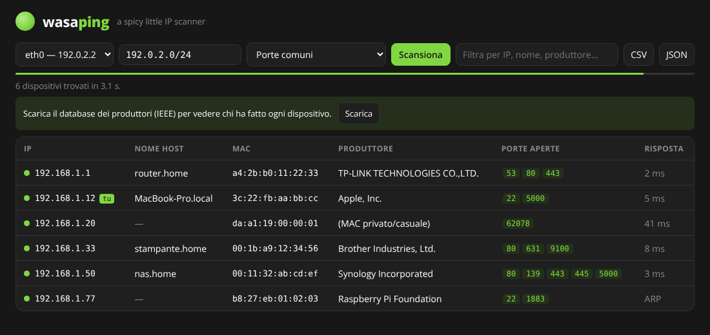

# wasaping 🟢

**a spicy little IP scanner**: uno scanner di rete multipiattaforma, nello stile di LanScan.
È un solo eseguibile per **Windows, macOS e Linux**, non va installato e non chiede i permessi di amministratore.



## Cosa fa

- Trova la tua rete locale da solo e la scansiona in pochi secondi (256 host in circa 1 s)
- Per ogni dispositivo mostra **IP, nome host, indirizzo MAC, produttore e porte aperte**
- Riconosce i **MAC privati/casuali** di iPhone e Android
- Ha un'**interfaccia grafica** nel browser (tema chiaro e scuro) e una **riga di comando** con output in tabella, JSON o CSV
- Le porte web (80, 443, 8080…) sono cliccabili e aprono il pannello del dispositivo

### Come trova i dispositivi senza permessi di amministratore

1. **Sonde TCP** in parallelo su porte comuni. Anche una connessione *rifiutata* dimostra che l'host è acceso.
2. Il **ping di sistema** per i dispositivi che non rispondono via TCP.
3. La **tabella ARP** del sistema operativo: le sonde precedenti la riempiono, così si vedono anche i dispositivi con tutte le porte chiuse da un firewall.

## Download

Prendi l'eseguibile per il tuo sistema dalla pagina [Releases](../../releases).

| Sistema | File |
|---|---|
| Windows | `wasaping-windows-amd64.exe` |
| macOS (Apple Silicon) | `wasaping-darwin-arm64` |
| macOS (Intel) | `wasaping-darwin-amd64` |
| Linux | `wasaping-linux-amd64` / `-arm64` |

> **macOS:** la prima volta il sistema blocca il file perché non è firmato. Esegui `xattr -d com.apple.quarantine wasaping-darwin-arm64`, oppure fai clic destro → Apri.

## Uso

```sh
wasaping web                 # apre l'interfaccia grafica nel browser
wasaping                     # scansiona la tua LAN dal terminale
wasaping 192.168.1.0/24      # una rete precisa
wasaping 10.0.0.1-50 -p none # un intervallo, senza controllare le porte
wasaping -o csv > rete.csv   # esporta in CSV (oppure -o json)
wasaping interfaces          # elenca le interfacce di rete
wasaping update-oui          # scarica il database dei produttori (IEEE)
```

Opzioni principali:

| Opzione | Default | Descrizione |
|---|---|---|
| `-i` | automatica | interfaccia da usare (`en0`, `eth0`, `Wi-Fi`…) |
| `-p` | `common` | porte da controllare: `common`, `none`, `22,80,443`, `1-1024` |
| `-timeout` | `800ms` | timeout per singolo tentativo |
| `-workers` | `128` | host sondati in parallelo |
| `-no-ping` | | non usa il ping di sistema |
| `-no-dns` | | non risolve i nomi host |
| `-o` | `table` | `table`, `json`, `csv` |

Il database dei produttori (circa 6 MB, dall'IEEE) si scarica una volta sola con `wasaping update-oui` o dal pulsante nell'interfaccia, e resta salvato nella cartella cache dell'utente.

## Compilare dai sorgenti

Ti serve [Go](https://go.dev/dl/) 1.22 o successivo. Non ci sono dipendenze esterne.

```sh
go build -o wasaping .
make release        # crea gli eseguibili di tutti i sistemi in dist/
go test ./...
```

## Struttura

```
main.go            riga di comando
web.go             server locale + API (SSE) per l'interfaccia
web/index.html     interfaccia grafica (incorporata nell'eseguibile)
scanner/           motore: rilevamento reti, sonde, ARP, porte, produttori
```

## Idee per le prossime versioni

- [ ] Nomi via mDNS/Bonjour e NetBIOS (per i dispositivi senza DNS inverso)
- [ ] Scansioni salvate e confronto ("nuovi dispositivi dall'ultima volta")
- [ ] Nomi personalizzati per i dispositivi
- [ ] IPv6
- [ ] Wake-on-LAN
- [ ] App desktop nativa (Wails) con icona nel dock e nella barra di sistema

## Licenza

MIT
